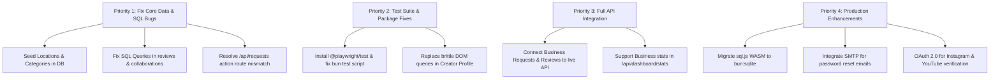

# GoaConnect (GoaCreatorDB) — Comprehensive Project Status Report

**Generated:** November 14, 2026  
**Repository:** `GoaCreatorDB` (`goa-creator`)  
**Target Platform:** The Premier Marketplace for Creators, Luxury Stays & Brands in Goa  
**Current Branch:** `main` (commit `54e5a19`)  
**Build Status:** ✅ Production Build Successful (`next build` compiled cleanly)  
**Lint Status:** ✅ Zero ESLint Errors/Warnings  
**Unit Tests:** ✅ 5/5 Unit Tests Passing  
**API Tests:** ⚠️ Pass with locations seeded; fails on clean clone due to missing locations seed  
**E2E Tests:** ⚠️ Blocked by missing `@playwright/test` package in `package.json`

---

## 1. Executive Summary

**GoaConnect** is a specialized, full-stack creator collaboration marketplace built specifically for the coastal ecosystem of Goa (North & South Goa). The platform bridges two primary user groups:
1. **Local Businesses & Hospitality Brands**: Boutique villas, heritage hotels, beach clubs, tavernas, artisanal cafes, and lifestyle venues looking for vetted, authentic influencer partnerships.
2. **Goan Content Creators & Influencers**: Storytellers, filmmakers, and lifestyle creators in niches like Food & Dining, Boutique Resorts, Nightlife, and Coastal Adventures seeking paid partnerships, barter stays, and verified portfolio showcasing.

### Current Overall Assessment
The project is in a **feature-complete MVP / late prototype stage**. The UI is exceptionally polished, adopting a distinct "sharp / 0px radius" coastal aesthetic with high-contrast forest green accents (`#0C4E40`), dark/light theme support, responsive layouts, and complete user journeys for both creators and businesses.

However, several **underlying technical discrepancies and architectural bottlenecks** exist in the database seeding, SQL queries, and API route bindings that prevent end-to-end operational readiness without targeted fixes.

---

## 2. Technology Stack Architecture

| Layer | Technology | Version | Notes |
|---|---|---|---|
| **Runtime & Package Manager** | [Bun](https://bun.sh) | `v1.4.2` | Fast JavaScript runtime, package manager, and test runner |
| **Framework** | [Next.js](https://nextjs.org) (App Router) | `16.4.5` | Turbopack enabled, experimental `agentFeedback` |
| **Frontend Library** | [React](https://react.dev) | `19.3.0` | Latest React 19 server & client components |
| **Styling** | [Tailwind CSS](https://tailwindcss.com) | `v4` | Turbopack CSS loader integration, CSS variables theme |
| **UI Primitives & Icons** | Base UI, Lucide React, Motion | `lucide-react@1.70.0`, `motion@14.11.1` | Sharp / 0px border-radius design system |
| **Database** | SQLite via [sql.js](https://sql.js.org) (WASM) | `1.16.0` | In-memory WASM SQLite with file export to `.data/goa-creator.db` |
| **Authentication** | Custom Session-Based + bcrypt | `bcrypt@6.0.0` | 12 salt rounds, 7-day UUID sessions in httpOnly cookies |
| **Testing** | Bun Test & Playwright | `playwright@1.65.0` | Unit & API tests via Bun; E2E via Playwright |

---

## 3. Module-by-Module Implementation Status

### 3.1 Public Landing & Authentication Flows

| Route | Purpose | Status | Details |
|---|---|---|---|
| `/` | Landing Page | **Complete** | Hero with Unsplash Goa visuals, trust metrics, workflow steps, pricing tiers, FAQs, CTA, and automated session redirect. |
| `/login` | Unified Sign In | **Complete** | Split-screen layout, Business vs Creator tabs, demo auto-fill credentials, password reveal toggle, dynamic role redirection. |
| `/join` | Multi-Step Onboarding | **Complete** | Role selection (Business vs Creator), location & category selectors, commercial terms, password strength meter. |
| `/register/business` | Dedicated Business Registration | **Complete** | Comprehensive business registration capturing GST/phone, location, industry, Instagram handle, and work email. |
| `/register` | Registration Redirect | **Complete** | Redirects to `/register/business`. |

### 3.2 Creator Workspace (`/creator/*`)

| Route | Feature Area | Status | Operational Notes |
|---|---|---|---|
| `/creator/dashboard` | Main Overview | **Complete** | Live stats (`/api/dashboard/stats`), pending request inbox, open-for-collabs toggle, profile completeness indicator. |
| `/creator/profile` | Public Profile & Rate Card | **Needs Refinement** | Deliverables selector, min floor rate, bio, and region tags. *Note: contains brittle DOM selector for saving data.* |
| `/creator/social` | Connected Accounts & Metrics | **Complete** | Instagram & YouTube connection cards, audience reach, engagement rate, manual metric sync trigger (`/api/social/sync`). |
| `/creator/requests` | Collaboration Requests Inbox | **Functional (Bugged Action Route)** | List and filter requests (pending, accepted, declined). Action button hits `/api/requests` which fails due to routing mismatch. |
| `/creator/collaborations` | Active & Past Collaborations | **Complete** | Tabbed lifecycle view (pending, accepted, in production, completed), payment & escrow tracking. |
| `/creator/reviews` | Reviews & Reputation | **Mock Data** | Displays verified venue reviews and ratings, but uses hardcoded `collabRows` rather than live `/api/reviews` endpoint. |

### 3.3 Business Workspace (`/business/*`)

| Route | Feature Area | Status | Operational Notes |
|---|---|---|---|
| `/business/dashboard` | Business Overview | **Complete** | Summary metrics, active collaboration cards, quick creator bookmarks, and recent requests. |
| `/business/discover` | Creator Discovery Engine | **Complete** | District filtering (North vs South Goa), niche badges, follower count, engagement rate, pricing, and grid/list views. |
| `/business/shortlist` | Saved Creators | **Complete** | Shortlisted creator cards with fast collaboration booking actions. |
| `/business/profile` | Creator Showcase View | **Complete** | Venue perspective of Sneha Fernandes's profile, verified badges, rate card, and booking triggers. |
| `/business/requests` | Outbound Request Tracking | **Mock Data** | Visual tracking of collaboration briefs, deliverables, and escrow states; currently uses static client data. |
| `/business/reviews` | Vendor Reviews Submission | **Mock Data** | Venue review submission form with star rating and review history; client-side simulation. |
| `Collaboration Modal` | Global Booking Drawer | **Complete** | Header-mounted modal calculating dynamic pricing based on deliverables (Reels, Carousels, Stories, Ad Licensing). |

---

## 4. API Endpoints Audit

| Endpoint | Method | Role | Status | Audit Findings |
|---|---|---|---|---|
| `/api/auth/register` | `POST` | Public | **Working** | Registers user & profile; requires foreign key to `locations`. |
| `/api/auth/login` | `POST` | Public | **Working** | Verifies bcrypt hash, creates 7-day session, sets cookie. |
| `/api/auth/logout` | `POST` | Auth | **Working** | Clears session cookie and deletes session record from DB. |
| `/api/auth/me` | `GET` | Auth | **Working** | Returns sanitized user and role-specific profile. |
| `/api/auth/forgot-password` | `POST` | Public | **Working (Token Only)** | Generates reset token (SMTP email integration pending). |
| `/api/auth/reset-password` | `POST` | Public | **Working** | Updates password hash using valid reset token. |
| `/api/creators` | `GET` | Public | **Working** | Queries `creator_profiles` with niche/location filters. |
| `/api/reels` | `GET` | Public | **Working** | Returns curated Goan creator reels with category & search filters. |
| `/api/dashboard/stats` | `GET` | Auth | **Buggy for Business** | Queries `creator_id = ?` unconditionally; business stats return 0. |
| `/api/profile` | `GET`, `PUT` | Auth | **Working** | Fetches and updates user and creator/business profile. |
| `/api/social/accounts` | `GET`, `POST`, `DELETE` | Creator | **Working** | Manages connected Instagram / YouTube accounts. |
| `/api/social/metrics` | `GET` | Creator | **Working** | Returns historical metrics snapshot. |
| `/api/social/sync` | `POST` | Creator | **Working** | Simulates creator-submitted audience metrics. |
| `/api/requests` | `GET`, `POST` | Auth | **Conflict** | `POST` creates requests (business only), conflicting with creator accept/decline action queries. |
| `/api/requests/[id]` | `POST` | Creator | **Route Mismatch** | Accept/decline logic is placed here, but reads `searchParams.get('id')` instead of route parameter. |
| `/api/collaborations` | `GET` | Auth | **Buggy for Business** | Filters `WHERE creator_id = ?`, returning empty data for business users. |
| `/api/collaborations/[id]` | `GET` | Auth | **Broken SQL Query** | Queries `u2.business_name` from `users` (column does not exist on `users`). |
| `/api/reviews` | `GET`, `POST` | Auth | **Broken SQL Query** | `SELECT c.title, u2.business_name` fails (neither column exists in target tables). |
| `/api/notifications` | `GET`, `PATCH` | Auth | **Working** | Retrieves user notifications and marks as read. |

---

## 5. Critical Issues & Technical Debt

### 🔴 Critical / Blocker Issues

1. **Foreign Key Failure on Database Seeding (`scripts/seed.ts`)**:
   - **Root Cause**: `locations` table is created empty. `seed.ts` attempts to insert businesses referencing `loc-2` and creators referencing `loc-1`.
   - **Impact**: Clean installs running `bun run scripts/seed.ts` fail with `FOREIGN KEY constraint failed`, leaving the database empty of seed businesses and creators.
   - **Resolution**: Seed `INITIAL_LOCATIONS` and `INITIAL_CATEGORIES` (already defined in `lib/types.ts`) inside `seed.ts` and `initDb()`.

2. **SQL Query Schema Mismatches**:
   - `app/api/reviews/route.ts` (GET): Queries `c.title` and `u2.business_name` from `collaborations c` and `users u2`. In the SQLite schema, `collaborations` has `campaign_brief` (not `title`), and `users` has only account credentials (business details are in `businesses.business_name`). This throws a 500 SQLite error when invoked.
   - `app/api/collaborations/[id]/route.ts`: Similar reference to `u2.business_name`.
   - **Resolution**: Adjust queries to `JOIN businesses b ON c.business_id = b.user_id` and select `b.business_name`.

3. **Routing Mismatch for Request Accept / Decline**:
   - The creator requests UI (`app/creator/requests/page.tsx`) sends `POST /api/requests?id=${requestId}&action=${action}`.
   - `app/api/requests/route.ts` rejects non-business callers with `403 Forbidden` because it expects a request creation payload.
   - The handler meant to process this is located at `app/api/requests/[id]/route.ts`, but it parses `searchParams` instead of route params.
   - **Resolution**: Align the UI to call `POST /api/requests/${requestId}?action=${action}` and update the `[id]` route handler to read `params.id`.

4. **Broken Test Runner in `package.json`**:
   - Running `bun test` invokes all tests in `tests/`, including `tests/e2e/app.test.ts`.
   - `tests/e2e/app.test.ts` imports `@playwright/test`, which is not installed (`package.json` only has `playwright`).
   - **Resolution**: Install `@playwright/test` or update `package.json` test script to `"test": "bun test tests/unit tests/api"`.

### 🟡 Moderate / Architectural Issues

5. **WASM In-Memory SQLite Concurrency & Persistence (`sql.js`)**:
   - `sql.js` executes in WebAssembly memory. Persistent disk writes require explicit `db.export()` buffer serialization to `.data/goa-creator.db`.
   - In Next.js App Router, concurrent requests or worker process restarts can lead to state inconsistency if an endpoint does not explicitly invoke `saveAndClose()`.
   - **Recommendation**: For production or native Bun performance, consider switching to `bun:sqlite` or LibSQL / SQLite embedded engine.

6. **Brittle DOM Query in Creator Profile Form**:
   - `app/creator/profile/page.tsx` line 107 extracts form values via `document.querySelector('input[defaultValue="Sneha Fernandes"]')`.
   - If user input changes or the profile is for another creator, state binding breaks.
   - **Recommendation**: Refactor to standard React controlled state.

7. **Client-Side Mock Data in Business Requests & Reviews**:
   - `app/business/requests/page.tsx` and `app/business/reviews/page.tsx` currently render static arrays rather than querying `/api/requests` and `/api/reviews`.

---

## 6. Security & Infrastructure Review

- **Password Security**: Excellent. Passwords hashed using `bcrypt` with 12 salt rounds. Minimum length of 6 enforced.
- **Session Security**: Session tokens are cryptographically secure random UUIDs stored in httpOnly cookies with `SameSite=lax`.
- **SQL Injection Prevention**: All dynamic values in SQL queries use parameterized queries (`?` bindings).
- **Audit Logging**: `audit_logs` table schema is implemented for sensitive administrative and transaction actions.
- **Environment Variables**: Sensible fallbacks implemented for `DATABASE_URL`, `AUTH_SECRET`, and `NEXT_PUBLIC_APP_URL`.

---

## 7. Actionable Roadmap & Priority Matrix

### Immediate Action Plan (Next Sprint)
1. **Database**: Update `lib/db.ts` to automatically populate `INITIAL_LOCATIONS` and `INITIAL_CATEGORIES` if the tables are empty on `initDb()`.
2. **API Fixes**: Correct `reviews` and `collaborations` queries to join `businesses` instead of projecting nonexistent columns on `users`.
3. **Route Alignment**: Fix the creator accept/decline action flow between `app/creator/requests/page.tsx` and `app/api/requests/[id]/route.ts`.
4. **Tooling**: Add `@playwright/test` to `devDependencies` and configure test commands in `package.json`.
5. **UI-to-API Binding**: Replace mock data on `/business/requests` and `/business/reviews` with `fetch` calls to backend endpoints.

---

*Report prepared following deep-dive static analysis, build verification, and test execution on `GoaCreatorDB`.*

